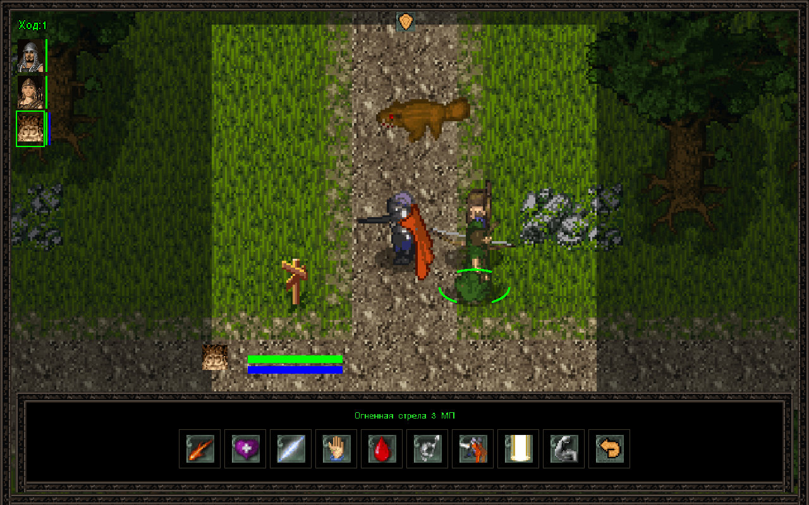
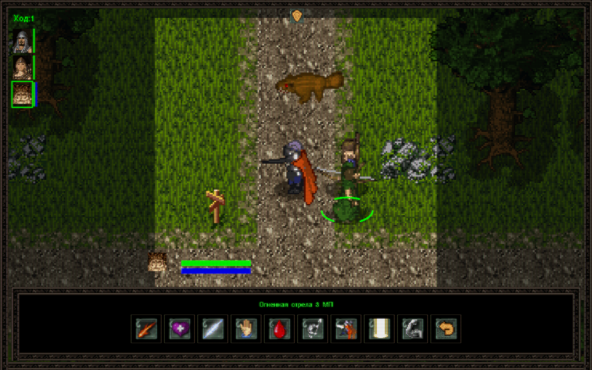

# Аллоды — фанатский проект на Godot

Фанатское восстановление мобильных «Аллодов» 2005 года на Godot 4.7.
Исследование мира, отряд героев и пошаговые бои — с управлением мышью
и клавиатурой.

Проект в разработке. Репозиторий содержит исходный код, сгенерированные
HD-изображения и их концепты. Оригинальные игровые архивы, извлечённая графика,
музыка, звуки и курсоры подключаются локально.

## Скриншоты

Оригинальная графика без HD: одна и та же сцена без фильтра и с CRT-фильтром.
Нажмите на изображение, чтобы открыть его в полном размере и рассмотреть эффект.

| Без фильтра | С CRT-фильтром |
| --- | --- |
| [](docs/screenshots/combat-crt-off.png) | [](docs/screenshots/combat-crt-on.png) |

Фильтр переключается в игровом меню: **Настройки → CRT-фильтр**.

## Что уже есть

- Исследование карт и подземелий, диалоги, задания и путешествия.
- Пошаговые бои: ближние и дальние атаки, 15 заклинаний, эффекты и действия отряда.
- Развитие персонажей, инвентарь, экипировка, торговля и добыча.
- Ручные сохранения и отдельное автосохранение при входе на карту или в подземелье.
- Настройки музыки и звуков, переключаемый HD-режим и CRT-фильтр.
- В HD-режиме — рисованные интерьеры таверны и магазина с проектными шрифтом
  и рамками, слухами, поручениями и торговлей.
- Справка по управлению в игровом меню.

Bluetooth-мультиплеер пока не реализован. Полное прохождение ещё требует проверки.

## Запуск из исходников

Нужны **Godot 4.7**, **Python 3.10+** и локальная копия исходной Java ME игры.
Без оригинальных данных игра не запустится; репозиторий их не распространяет.

1. Клонируйте репозиторий.
2. Поместите `allods_360x640_bluetooth_rus.jar` в корень проекта.
3. Подготовьте игровые данные из корня проекта:

```powershell
python tools/allods_tool.py extract allods_360x640_bluetooth_rus.jar analysis/extracted
python tools/allods_tool.py export-godot analysis/extracted godot/data
```

4. Откройте `godot/project.godot` в Godot, дождитесь импорта ресурсов и нажмите **F5**.

Сгенерированные HD-фоны, портреты и значки входят в репозиторий вместе с
промптами и метаданными. Концепты находятся в `godot/art/concepts/`, рабочие фоны —
в `godot/art/ui/`, портреты и значки — в `godot/data/hd/icons/`.
Музыка, дополнительные звуки и извлечённые курсоры подключаются локально.
Отсутствие этих дополнительных ресурсов не мешает запуску с оригинальной графикой.

Настройки → **HD-режим** включает HD-иконки и новые экраны таверны, магазина,
инвентаря, развития персонажа и журнала. В книге отряда работают вкладки,
общая сумка с фильтрами, сравнение экипировки, гнёзда и черновик прокачки.
Главное и внутриигровое меню, настройки, справка и выбор сохранения также
получают HD-оформление. Фон главного меню — `godot/art/ui/hd-menu-v1/title-v1.png`.
Город, карта мира, подбор добычи и результаты боя тоже имеют HD-экраны;
длинные списки наград разбиваются на страницы с доступной кнопкой продолжения.
Фоны города, таверны и магазина находятся в `godot/art/ui/hd-town-v1/`.
Без соответствующего фона экран использует исходное оформление. Карта мира
сохраняет исходную географию и добавляет список открытых локаций и крупные маркеры.

## Управление

**WASD / стрелки** — движение. **ЛКМ** — выбрать путь или цель,
повторный клик — выполнить действие. **Esc** — меню.
Полная памятка доступна в пункте «Управление».

## Обратная связь

Сообщения об ошибках и предложения можно оставлять в Issues.
Для ошибки полезны шаги воспроизведения, версия Godot и описание ожидаемого поведения.

## Авторы и права

Это неофициальный фанатский проект, не связанный с правообладателями и не одобренный ими.
Оригинальная мобильная игра — **© 2005 Нивал Интерактив / Nival Interactive**.
Права на оригинальные материалы и торговые марки принадлежат соответствующим
правообладателям. Все права на оригинальные материалы сохранены.

Атрибуция и сведения о сторонних компонентах — в [THIRD_PARTY_NOTICES.md](THIRD_PARTY_NOTICES.md).
